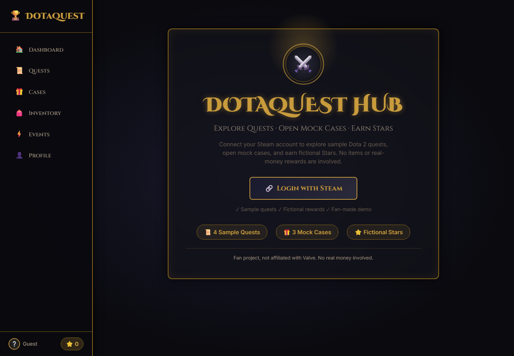

# DotaQuest Hub

DotaQuest Hub is a Dota 2 fan demo for exploring quests, opening mock cases, and earning fictional Stars with Steam sign-in.



**Live demo:** Not deployed yet.

> Fan project, not affiliated with Valve. No real money involved. Cases, items, and rewards are illustrative demo content and do not grant real Steam items.

## Features

- Sign in with Steam using Passport
- Browse sample daily and weekly quests
- Submit a match ID for OpenDota-based quest checks
- Explore three sample cases and a fictional Stars balance
- Save account progress to a local JSON file
- Responsive dark fantasy interface

Case rewards, the inventory, referral links, and some account features are mock/demo functionality; they do not interact with the Steam item marketplace.

## Tech stack

- **Frontend:** HTML, CSS, and vanilla JavaScript
- **Backend:** Node.js and Express
- **Authentication:** Passport and `passport-steam`
- **Persistence:** JSON file at `data/users.json` (local development only; not suitable for multi-instance or ephemeral deployments)
- **Match data:** OpenDota API

## Getting started

### Prerequisites

- Node.js 16 or newer
- npm
- A Steam Web API key from [steamcommunity.com/dev/apikey](https://steamcommunity.com/dev/apikey)

### Install and run

```bash
git clone https://github.com/Baichau/Dota_app.git
cd Dota_app
npm install
```

Copy `.env.example` to `.env` (PowerShell: `Copy-Item .env.example .env`) and set:

- `STEAM_API_KEY` to your Steam Web API key
- `SESSION_SECRET` to a unique, random secret of at least 32 characters

For local use, the example Steam realm and return URL use `http://localhost:3000`. Register the matching domain and callback URL with Steam, then start the app:

```bash
npm start
```

Open [http://localhost:3000](http://localhost:3000). Never commit `.env`; it contains credentials. The app writes signed-in user data to `data/users.json`, which is ignored by Git.

## Deployment notes

The app has no hosted demo yet. For a deployment, set `NODE_ENV=production`, configure `STEAM_REALM` and `STEAM_RETURN_URL` to the HTTPS domain registered with Steam, and provide `STEAM_API_KEY` and a fresh `SESSION_SECRET` as host environment variables. The local JSON store is not durable on ephemeral hosts; migrate it to a managed database before relying on hosted persistence.

## What I would improve next

1. Move user data to a managed database with migrations and backups.
2. Replace demo inventory, cases, and reward flows with clearly scoped, verifiable functionality.
3. Add automated tests for authentication, quest validation, and account saves.
4. Deploy a live demo with production secrets managed by the host.
